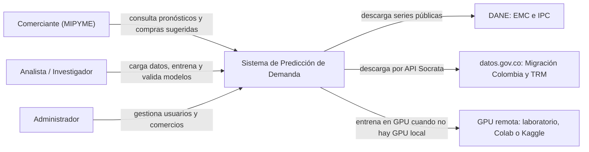
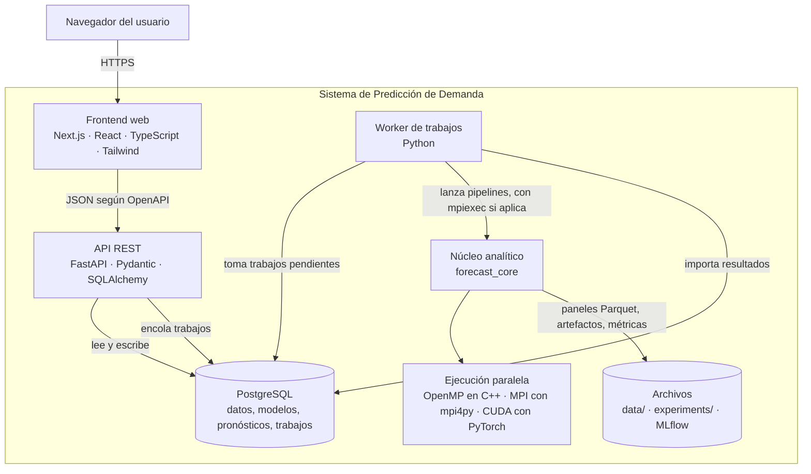
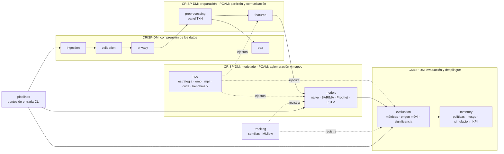
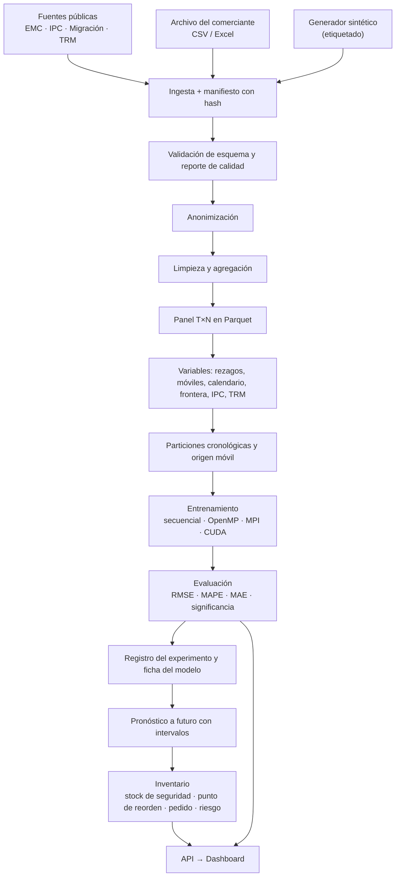
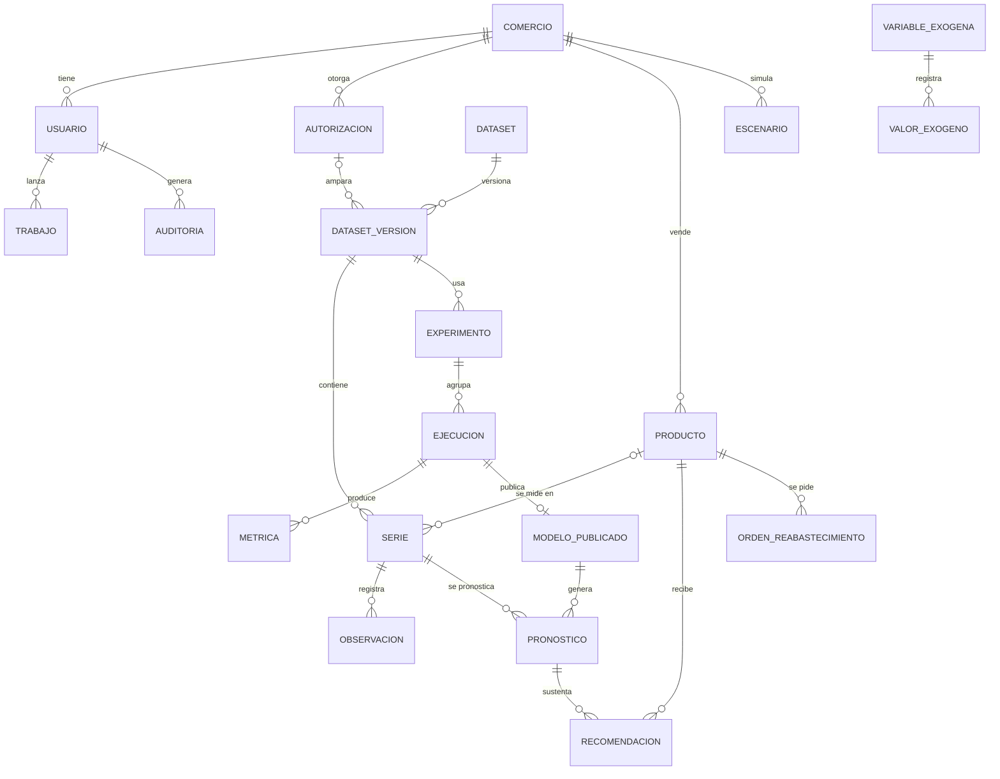

# Arquitectura del Sistema

**Proyecto:** Sistema de Predicción de Demanda para el Comercio Minorista Fronterizo
**Versión:** 1.0 — 16/11/2026
**Uso:** guía de la **Fase 0** del plan de gestión: con este documento se crea la jerarquía de carpetas y archivos de `Codigo Fuente/`.

---

## 1. Principios de arquitectura

| # | Principio | Consecuencia | Requerimientos |
|---|---|---|---|
| P1 | **El núcleo analítico es independiente.** | `forecast_core` no importa nada de la API ni de la web. Se puede usar desde la terminal, desde cuadernos, con `mpiexec` o desde el worker. | RNF-23 |
| P2 | **La API es la única puerta a los datos.** | El frontend nunca accede a PostgreSQL; todo pasa por FastAPI con validación y control de acceso. | RNF-16, RNF-17 |
| P3 | **Primero secuencial, luego paralelo.** | Cada etapa paralela tiene una versión secuencial con la misma interfaz y pruebas de equivalencia. | RF-34, RF-39 |
| P4 | **La estrategia de ejecución se elige por configuración.** | Secuencial, OpenMP, MPI, CUDA o MPI + CUDA sin tocar el código del pipeline. | RF-38 |
| P5 | **Todo resultado es reproducible y trazable.** | Configuración en YAML, semillas fijas, versión de datos con hash, commit y entorno registrados en cada experimento. | RNF-25, RNF-27, RNF-28 |
| P6 | **Ninguna cifra sin origen.** | Toda métrica que muestre la interfaz o el informe proviene de una ejecución registrada. | RF-61, RNF-20 |
| P7 | **Privacidad desde el diseño.** | Anonimización en la ingesta; datos privados nunca en el repositorio. | RF-08, RNF-19 |
| P8 | **Hardware accesible primero.** | Consultar y pronosticar funciona sin GPU; la GPU solo acelera el entrenamiento. | RNF-07, RNF-13 |

---

## 2. Vista de contexto



## 3. Vista de contenedores



| Contenedor | Responsabilidad | Tecnología |
|---|---|---|
| **Frontend web** | Presentación: tableros, consultas, formularios, exportación. Sin lógica de negocio. | Next.js, React, TypeScript, Tailwind CSS, TanStack Query, Recharts o ECharts, zod |
| **API REST** | Autenticación, autorización por rol y comercio, validación, casos de uso, encolado de trabajos. | FastAPI, Pydantic v2, SQLAlchemy 2, Alembic |
| **Worker** | Ejecuta trabajos largos (ingesta, entrenamiento, validación, benchmark). Lanza `mpiexec` para los pipelines paralelos e importa los resultados a la base de datos. | Python; cola en PostgreSQL con `SELECT … FOR UPDATE SKIP LOCKED` |
| **Núcleo analítico** | Ingesta, calidad, privacidad, preparación, variables, EDA, modelos, evaluación, inventario y estrategias de paralelismo. | pandas, numpy, statsmodels, Prophet, PyTorch, mpi4py |
| **Núcleos OpenMP** | Cálculo de variables y métricas sobre la matriz T×N con varios hilos. | C++17, OpenMP, pybind11, CMake, scikit-build-core |
| **PostgreSQL** | Datos estructurados, metadatos de experimentos, pronósticos, recomendaciones, trabajos y auditoría. | PostgreSQL 16 o superior |
| **Archivos** | Datos crudos y procesados (Parquet), artefactos de modelos, registros de MLflow. | Sistema de archivos local o volumen de Docker |

**¿Por qué la cola de trabajos en PostgreSQL y no Celery o RQ?** RQ no funciona en Windows y Celery tiene soporte limitado allí; el equipo desarrolla en Windows. Una tabla `trabajos` con bloqueo `SKIP LOCKED` no agrega infraestructura, funciona igual en Windows, WSL y Docker, y es suficiente para el volumen de un proyecto académico.

---

## 4. Vista de componentes del núcleo analítico



### 4.1 Interfaz común de modelos

Todos los modelos implementan la misma interfaz, para compararse bajo las mismas condiciones (RF-28):

```python
class Forecaster(Protocol):
    name: str
    def fit(self, y: np.ndarray, X: np.ndarray | None = None) -> "Forecaster": ...
    def predict(self, horizon: int, X_future: np.ndarray | None = None) -> Forecast: ...
    def save(self, path: Path) -> None: ...
    @classmethod
    def load(cls, path: Path) -> "Forecaster": ...

@dataclass
class Forecast:
    mean: np.ndarray                         # (horizonte, N series)
    intervals: dict[float, tuple[np.ndarray, np.ndarray]]  # {0.8: (inf, sup), 0.95: (inf, sup)}
```

### 4.2 Estrategia de ejecución

```python
class ExecutionStrategy(Protocol):
    def map_series(self, fn, panel: Panel) -> Panel: ...        # por serie / bloque de series
    def map_tasks(self, fn, tasks: list[Task]) -> list[Result]: ...  # orígenes, semillas, configuraciones

# Implementaciones: Sequential, OpenMP(threads=h), MPI(procs=p), CUDA(device), MPICUDA(procs=p)
# Se elige en configs/hpc.yaml o con --strategy en la línea de comandos.
```

---

## 5. Flujo de datos de extremo a extremo



---

## 6. Diseño de la paralelización (PCAM)

Amplía la Tabla VIII del informe de OE1/OE2 con las etapas de aglomeración y mapeo, que corresponden al OE3.

| Etapa | Partición | Comunicación | Aglomeración | Mapeo | Tecnología | Métrica |
|---|---|---|---|---|---|---|
| Ingesta y limpieza de series | Por fuente o por bloque de series | Reunión del panel en el proceso raíz (`gather`) | Bloques de series de tamaño similar por proceso | Un proceso por núcleo o nodo | MPI | Tiempo, *S(p)*, *E(p)* |
| Cálculo de variables | Por serie (columna de la matriz T×N) | Ninguna: escritura en un arreglo compartido | Bloques de columnas por hilo; planificación estática o dinámica según la carga | Hilos sobre los núcleos de una máquina | OpenMP (C++) | *S(h)* por número de hilos |
| Entrenamiento de la LSTM | Por lotes de ventanas y operaciones matriciales; por serie en modo multimodelo | Copia de lotes de CPU a GPU; pesos y pronósticos de GPU a CPU | Muchas series pequeñas agrupadas en un mismo tensor para ocupar la GPU | Núcleos de cuDNN en la GPU | CUDA (PyTorch) | Tiempo en GPU frente a CPU |
| Validación con origen móvil, semillas e hiperparámetros | Un origen, una semilla o una configuración por tarea | Recolección de pronósticos y métricas en el proceso raíz | Varias tareas por proceso cuando hay más tareas que procesos | Procesos MPI, cada uno con su GPU o CPU | MPI (+ CUDA) | *S(p)*, *E(p)* |
| SARIMA y Prophet por serie | Por serie | Reunión de resultados | Bloques de series por proceso | Procesos MPI | MPI | *S(p)* |

**Medición (RF-40):** *S(p) = T₁ / Tₚ*, *E(p) = S(p) / p*; la fracción paralelizable *f* se estima ajustando la ley de Amdahl *S(p) ≤ 1 / [(1 − f) + f / p]* a las mediciones. Cada configuración se repite al menos 5 veces y se reportan mediana y rango.

---

## 7. Modelo de datos



| Entidad | Atributos principales |
|---|---|
| `comercio` | id, código seudónimo, municipio, tipo de negocio |
| `usuario` | id, correo, hash de contraseña, rol (admin, analista, comerciante), comercio |
| `autorizacion` | id, comercio, fecha, alcance, finalidad, referencia del documento firmado |
| `dataset` / `dataset_version` | origen (público, transaccional, sintético), fuente, frecuencia; versión, hash, fecha de ingesta, reporte de calidad (JSON) |
| `serie` / `observacion` | nivel (producto, categoría, comercio, agregado), clave; fecha (tipo `date`), valor |
| `evento` | tipo (festivo, quincena, cierre, reapertura, otro), fecha inicio y fin, descripción, fuente |
| `variable_exogena` / `valor_exogeno` | nombre, fuente, frecuencia; fecha, ámbito, valor |
| `producto` | código, nombre, categoría, costo, precio, tiempo de reposición, nivel de servicio objetivo, stock actual |
| `experimento` / `ejecucion` | configuración, versión de datos, commit; modelo, hiperparámetros, semilla, estrategia, unidades de cómputo, hardware, tiempos, id de MLflow |
| `metrica` | ejecución, serie (opcional), origen de validación, nombre, valor |
| `modelo_publicado` | ejecución, nivel, vigente, ficha del modelo (JSON), ruta del artefacto |
| `pronostico` | serie, fecha de origen, fecha objetivo, valor, límites al 80 % y 95 % |
| `recomendacion` | producto, fecha, stock de seguridad, punto de reorden, cantidad sugerida, riesgo, explicación |
| `escenario`, `orden_reabastecimiento` | parámetros y resultado (hipotético); cantidad y estado |
| `trabajo` | tipo, parámetros, estado, progreso, intentos, ruta de registros |
| `auditoria` | usuario, acción, entidad, detalle, fecha |

Las observaciones transaccionales de gran volumen se guardan también como Parquet en `data/processed/` para los pipelines; PostgreSQL conserva lo que consulta la API.

---

## 8. API REST (versión 1)

| Recurso | Endpoints | Roles |
|---|---|---|
| Autenticación | `POST /auth/login`, `GET /auth/me` | Todos |
| Comercios y usuarios | `GET/POST/PATCH /comercios`, `GET/POST/PATCH /usuarios` | Admin |
| Conjuntos de datos | `GET /datasets`, `POST /datasets/carga` (archivo), `POST /datasets/publicos/{fuente}/sincronizar`, `GET /datasets/{id}/versiones/{v}/calidad` | Analista; comerciante solo su carga |
| Series | `GET /series`, `GET /series/{id}/observaciones` | Según comercio |
| Patrones (EDA) | `GET /patrones/{serie}/descomposicion`, `GET /patrones/correlacion-frontera`, `GET /patrones/inflacion` | Todos |
| Experimentos | `GET /experimentos`, `POST /experimentos` (encola), `GET /experimentos/{id}/comparacion` | Analista |
| Modelos | `GET /modelos`, `POST /modelos/{ejecucion}/publicar`, `GET /modelos/{id}/ficha` | Analista; lectura para todos |
| Pronósticos | `GET /pronosticos?serie=&desde=&hasta=`, `POST /pronosticos/generar` (encola) | Según comercio |
| Inventario | `GET/POST/PATCH /productos`, `GET /inventario/recomendaciones`, `POST /inventario/simulacion` (encola) | Según comercio |
| Escenarios | `GET/POST /escenarios` | Según comercio |
| Rendimiento | `GET /rendimiento/benchmarks` | Analista |
| Trabajos | `GET /trabajos`, `GET /trabajos/{id}`, `POST /trabajos/{id}/cancelar` | Quien lo lanzó; admin |
| Salud | `GET /health` | Público |

La especificación OpenAPI se publica en `/docs` y de ella se generan los tipos del frontend (`frontend/src/lib/api/schema.d.ts`).

---

## 9. Stack tecnológico

Las versiones exactas se fijan en los archivos de bloqueo (`uv.lock`, `package-lock.json`) durante la Fase 0, usando la última versión estable de cada componente.

| Capa | Tecnología | Propósito | Licencia |
|---|---|---|---|
| Lenguaje backend | Python 3.12 | Núcleo, API, worker | PSF |
| Gestión de entorno | uv | Dependencias y archivo de bloqueo | MIT / Apache-2.0 |
| Datos | pandas, numpy, pyarrow | Tablas, matrices, Parquet | BSD / Apache-2.0 |
| Validación de datos | pandera | Esquemas de entrada | MIT |
| Calendario | holidays | Festivos de Colombia | MIT |
| Modelos estadísticos | statsmodels | ARIMA, SARIMA, SARIMAX, descomposición STL | BSD-3 |
| Prophet | prophet (cmdstanpy) | Tendencia, estacionalidad, festivos | MIT |
| Deep learning y CUDA | PyTorch con CUDA 12 | LSTM en CPU y GPU | BSD-3 |
| CUDA Toolkit / cuDNN | NVIDIA | Ejecución en GPU | **Gratuita, licencia propietaria de NVIDIA** (no es código abierto; se declara en el inventario de licencias) |
| MPI | mpi4py + OpenMPI (Linux/WSL2) o MS-MPI (Windows) | Procesamiento distribuido | BSD / BSD-3 / MIT |
| OpenMP | C++17, OpenMP, pybind11, CMake, scikit-build-core | Núcleos multihilo invocables desde Python | Varias permisivas (BSD-3, Apache-2.0) |
| Seguimiento de experimentos | MLflow (almacenamiento local) | Parámetros, métricas, artefactos | Apache-2.0 |
| API | FastAPI, Pydantic v2, Uvicorn | Servicio REST y OpenAPI | MIT / BSD-3 |
| Persistencia | PostgreSQL 16+, SQLAlchemy 2, Alembic, psycopg 3 | Base de datos y migraciones | PostgreSQL / MIT / LGPL-3 |
| Seguridad | argon2-cffi, PyJWT | Hash de contraseñas, tokens | MIT |
| Frontend | Next.js, React, TypeScript, Tailwind CSS | Interfaz | MIT |
| Datos en el frontend | TanStack Query, zod, openapi-typescript | Consultas, validación, tipos | MIT |
| Gráficas | Recharts o Apache ECharts | Series con intervalos, barras, calor | MIT / Apache-2.0 |
| Pruebas | pytest, pytest-cov, hypothesis, Vitest, Testing Library, Playwright | Unitarias, propiedades, integración, extremo a extremo | MIT / Apache-2.0 |
| Calidad | ruff, mypy, ESLint, Prettier, pre-commit | Estilo, tipos, ganchos | MIT |
| CI | GitHub Actions | Integración continua | Servicio |
| Despliegue | Docker y Docker Compose | Entorno reproducible | Apache-2.0 |
| Runtime del frontend | Node.js LTS vigente | Ejecutar Next.js | MIT |

---

## 10. Jerarquía de carpetas y archivos de `Codigo Fuente/`

Esta es la estructura que se crea en la Fase 0. Los comentarios indican el contenido y el requerimiento que atiende cada parte.

```text
Codigo Fuente/
├── README.md                         # Instalación, ejecución, estructura y comandos
├── .env.example                      # Variables de entorno de ejemplo (sin secretos)
├── .gitignore                        # Excluye data/, experiments/, .env, artefactos
├── docker-compose.yml                # Servicios: db, api, worker, web
├── Makefile                          # Atajos para Linux/WSL (setup, test, reproduce-oe1…)
├── tasks.ps1                         # Atajos equivalentes para Windows PowerShell
│
├── configs/                          # Configuración declarativa (RNF-25)
│   ├── data_sources.yaml             # URL, fecha de corte y reglas por fuente
│   ├── calendar_events.yaml          # Festivos, quincenas, cierres y reaperturas (RF-05)
│   ├── features.yaml                 # Variables por frecuencia (RF-15)
│   ├── inventory.yaml                # Niveles de servicio y costos (RF-47)
│   ├── hpc.yaml                      # Estrategia, hilos, procesos, dispositivo (RF-38)
│   └── experiments/
│       ├── e01_lineas_base_publico.yaml
│       ├── e02_sarima_publico.yaml
│       ├── e03_prophet_publico.yaml
│       ├── e04_lstm_publico.yaml         # Réplica del piloto del informe
│       ├── e05_ablacion_frontera.yaml    # RF-44
│       └── e10_benchmark_sintetico.yaml  # RF-40
│
├── data/                             # No versionado, salvo .gitkeep y manifest.json
│   ├── raw/
│   │   ├── public/                   # Anexos del DANE, Migración y TRM tal como se descargan
│   │   └── private/                  # Archivos de comercios (se anonimizan al ingresar)
│   ├── interim/                      # Datos limpios intermedios
│   ├── processed/                    # Paneles T×N en Parquet
│   ├── synthetic/                    # Datos sintéticos generados con semilla fija
│   └── manifest.json                 # Fuente, fecha y hash de cada archivo (RF-11)
│
├── backend/                          # Todo el código Python
│   ├── pyproject.toml                # Dependencias y configuración de ruff, mypy y pytest
│   ├── uv.lock
│   ├── alembic.ini
│   ├── migrations/                   # Migraciones de la base de datos (Alembic)
│   ├── src/
│   │   ├── forecast_core/            # NÚCLEO ANALÍTICO (independiente de la web)
│   │   │   ├── __init__.py
│   │   │   ├── config.py             # Carga y valida los YAML
│   │   │   ├── types.py              # Panel, Forecast, Task, Result
│   │   │   ├── ingestion/            # RF-01 a RF-06, RF-10
│   │   │   │   ├── dane_emc.py
│   │   │   │   ├── dane_ipc.py
│   │   │   │   ├── migracion.py
│   │   │   │   ├── trm.py            # Migrado del prototipo (00_download_real_data.py)
│   │   │   │   ├── calendar.py
│   │   │   │   ├── transactional.py  # Plantilla CSV/Excel de comercios
│   │   │   │   └── synthetic.py      # Migrado del prototipo (data_generation.py)
│   │   │   ├── validation/           # RF-07
│   │   │   │   ├── schemas.py
│   │   │   │   └── quality.py
│   │   │   ├── privacy/              # RF-08
│   │   │   │   └── anonymization.py
│   │   │   ├── preprocessing/        # RF-12 a RF-14
│   │   │   │   ├── cleaning.py
│   │   │   │   ├── aggregation.py
│   │   │   │   └── panel.py          # Matriz T×N (base: data_loader.py del prototipo)
│   │   │   ├── features/             # RF-15
│   │   │   │   ├── lags.py
│   │   │   │   ├── rolling.py
│   │   │   │   ├── calendar_features.py
│   │   │   │   └── exogenous.py
│   │   │   ├── eda/                  # RF-18 a RF-23
│   │   │   │   ├── decomposition.py
│   │   │   │   ├── growth.py
│   │   │   │   ├── inflation.py
│   │   │   │   ├── cross_correlation.py
│   │   │   │   └── report.py
│   │   │   ├── models/               # RF-24 a RF-33
│   │   │   │   ├── base.py           # Interfaz Forecaster
│   │   │   │   ├── naive.py          # Base: baselines.py del prototipo
│   │   │   │   ├── sarima.py
│   │   │   │   ├── prophet_model.py
│   │   │   │   ├── lstm/
│   │   │   │   │   ├── network.py
│   │   │   │   │   ├── dataset.py
│   │   │   │   │   └── trainer.py
│   │   │   │   └── registry.py
│   │   │   ├── evaluation/           # RF-16, RF-41 a RF-45
│   │   │   │   ├── metrics.py        # Base: metrics.py del prototipo
│   │   │   │   ├── backtesting.py    # Base: validation.py del prototipo
│   │   │   │   ├── significance.py
│   │   │   │   └── report.py
│   │   │   ├── inventory/            # RF-47 a RF-51
│   │   │   │   ├── policies.py
│   │   │   │   ├── risk.py
│   │   │   │   ├── simulation.py
│   │   │   │   └── kpis.py
│   │   │   ├── hpc/                  # RF-34 a RF-40
│   │   │   │   ├── strategy.py       # Secuencial / OpenMP / MPI / CUDA / MPI+CUDA
│   │   │   │   ├── omp.py            # Puente a hpc_kernels, con respaldo en NumPy
│   │   │   │   ├── mpi.py            # Reparto y reunión con mpi4py
│   │   │   │   ├── cuda.py           # Dispositivo, lotes, modelos simultáneos
│   │   │   │   └── benchmark.py      # Tiempos, S(p), E(p), ajuste de Amdahl
│   │   │   ├── tracking/
│   │   │   │   ├── seeds.py
│   │   │   │   └── mlflow_utils.py
│   │   │   └── pipelines/            # Puntos de entrada (python -m … o mpiexec -n p python -m …)
│   │   │       ├── ingest.py
│   │   │       ├── prepare.py
│   │   │       ├── train.py
│   │   │       ├── backtest.py
│   │   │       ├── forecast.py
│   │   │       └── benchmark.py
│   │   │
│   │   └── forecast_api/             # SERVICIO WEB (FastAPI)
│   │       ├── __init__.py
│   │       ├── main.py               # Aplicación, CORS, routers
│   │       ├── core/
│   │       │   ├── config.py         # Variables de entorno
│   │       │   ├── security.py       # Hash, tokens, dependencias de rol
│   │       │   └── logging.py
│   │       ├── db/
│   │       │   ├── session.py
│   │       │   ├── base.py
│   │       │   └── models/           # Una clase SQLAlchemy por entidad (sección 7)
│   │       ├── schemas/              # Modelos Pydantic de entrada y salida
│   │       ├── repositories/         # Acceso a datos
│   │       ├── services/             # Casos de uso: datasets, forecasts, inventory, jobs
│   │       ├── api/
│   │       │   └── v1/               # Un router por recurso (sección 8)
│   │       └── worker/
│   │           └── runner.py         # Toma trabajos y lanza pipelines (mpiexec si aplica)
│   │
│   └── tests/
│       ├── conftest.py
│       ├── unit/                     # Por módulo del núcleo y de la API
│       ├── integration/              # API + base de datos de prueba
│       ├── equivalence/              # Paralelo ≡ secuencial (RF-39)
│       ├── hpc/                      # Marcadores: mpi, cuda (se omiten si no hay recurso)
│       └── fixtures/                 # Datos pequeños de prueba, sin datos reales de comercios
│
├── hpc_kernels/                      # NÚCLEOS OPENMP EN C++ (RF-35)
│   ├── CMakeLists.txt
│   ├── pyproject.toml                # scikit-build-core + pybind11 → módulo _omp_kernels
│   ├── include/hpc_kernels/
│   │   ├── features.hpp
│   │   └── metrics.hpp
│   ├── src/
│   │   ├── features_omp.cpp          # Rezagos, medias móviles y variaciones por bloques de series
│   │   ├── metrics_omp.cpp
│   │   └── bindings.cpp
│   └── tests/
│
├── frontend/                         # NEXT.JS (solo presentación)
│   ├── package.json
│   ├── package-lock.json
│   ├── next.config.ts
│   ├── tsconfig.json
│   ├── eslint.config.mjs
│   ├── postcss.config.mjs
│   ├── .env.example                  # URL de la API
│   ├── src/
│   │   ├── app/
│   │   │   ├── layout.tsx            # Tipografías y estilos del prototipo
│   │   │   ├── globals.css
│   │   │   ├── login/page.tsx
│   │   │   └── (panel)/
│   │   │       ├── layout.tsx        # Navegación y sesión
│   │   │       ├── page.tsx          # Panel principal (RF-53)
│   │   │       ├── pronosticos/page.tsx   # RF-54
│   │   │       ├── patrones/page.tsx      # RF-55
│   │   │       ├── inventario/page.tsx    # RF-58
│   │   │       ├── escenarios/page.tsx    # RF-51
│   │   │       ├── modelos/page.tsx       # RF-56
│   │   │       ├── rendimiento/page.tsx   # RF-57
│   │   │       ├── datos/page.tsx         # RF-59
│   │   │       └── metodologia/page.tsx   # Contenido del panel del prototipo, con cifras reales
│   │   ├── components/
│   │   │   ├── ui/                   # Botones, tablas, tarjetas, avisos
│   │   │   ├── charts/               # Serie con intervalos, barras, calor
│   │   │   ├── forecast/
│   │   │   ├── inventory/
│   │   │   └── border/               # Esquema del corredor fronterizo
│   │   ├── lib/
│   │   │   ├── api/
│   │   │   │   ├── client.ts
│   │   │   │   └── schema.d.ts       # Generado desde OpenAPI (no editar a mano)
│   │   │   ├── auth.ts
│   │   │   └── format.ts             # Formato de moneda y números es-CO
│   │   └── hooks/
│   └── tests/
│       ├── unit/                     # Vitest + Testing Library
│       └── e2e/                      # Playwright
│
├── notebooks/                        # Análisis reproducibles que usan forecast_core
│   ├── 01_patrones_consumo_OE1.ipynb
│   ├── 02_seleccion_modelos_OE2.ipynb
│   ├── 03_rendimiento_paralelo_OE3.ipynb
│   ├── 04_validacion_OE4.ipynb
│   └── legacy/                       # Cuaderno de Colab del piloto LSTM (referencia)
│
├── scripts/
│   ├── setup_wsl_hpc.sh              # OpenMPI, CMake, g++ en WSL2
│   ├── setup_dev.ps1                 # Entorno de desarrollo en Windows
│   ├── run_benchmark_mpi.sh
│   └── backup_db.sh                  # RNF-14
│
├── infra/
│   ├── docker/
│   │   ├── api.Dockerfile
│   │   ├── worker.Dockerfile         # Con OpenMPI; variante con CUDA opcional
│   │   └── web.Dockerfile
│   └── gpu_remota/
│       └── run_cuda_experiments.ipynb   # Ejecución en Colab o Kaggle cuando no hay GPU local
│
└── experiments/                      # Salidas (no versionado): mlruns/, results/, figures/
```

Archivos en la **raíz del repositorio** (GitHub los exige allí):

```text
.github/
├── workflows/ci.yml                  # Usa working-directory: "Codigo Fuente"
├── pull_request_template.md
└── ISSUE_TEMPLATE/
LICENSE
```

La carpeta `Prototipo/` se conserva como referencia histórica de solo lectura; al terminar la Fase 0 se agrega un aviso en su README indicando que fue reemplazada.

**Nota sobre la ruta:** `Codigo Fuente` contiene un espacio. CMake, `mpiexec` y algunos scripts pueden fallar con rutas con espacios si no se escriben entre comillas. Todos los scripts del proyecto deben citar las rutas; si aparecen problemas persistentes, renombrar la carpeta a `codigo-fuente` es una opción de bajo costo.

---

## 11. Entornos

| Entorno | Uso | Configuración |
|---|---|---|
| **Desarrollo Windows** | API, frontend, núcleo en modo secuencial | Python 3.12 con uv, Node.js LTS, PostgreSQL local o en Docker |
| **Desarrollo HPC (WSL2 Ubuntu)** | OpenMP, MPI, compilación de `hpc_kernels` | g++, CMake, OpenMPI, mpi4py |
| **GPU** | Entrenamiento CUDA y benchmarks de GPU | Equipo con GPU NVIDIA de un integrante, laboratorio de la universidad, o Colab/Kaggle con `infra/gpu_remota/` |
| **Integración continua** | Lint, tipos, pruebas (incluidas MPI con `mpiexec -n 2`), compilación | GitHub Actions en Ubuntu; las pruebas CUDA se omiten |
| **Despliegue / demostración** | Sistema completo | Docker Compose |

## 12. Convenciones

- **Idioma:** código, nombres de archivos y de variables en inglés; documentación, mensajes de interfaz y comentarios de negocio en español.
- **Python:** PEP 8 con ruff, tipado obligatorio en funciones públicas, docstrings en estilo NumPy.
- **TypeScript:** modo estricto, componentes de menos de 300 líneas, sin lógica de negocio en el cliente.
- **Ramas:** `feat/RF-xx-descripcion`, `fix/…`, `exp/…`, `docs/…`; *pull request* hacia `main` con al menos una aprobación.
- **Commits:** Conventional Commits (`feat:`, `fix:`, `test:`, `docs:`, `refactor:`, `exp:`).
- **Decisiones:** cada decisión relevante se registra como ADR en `Documentacion Tecnica/ADR/`.
